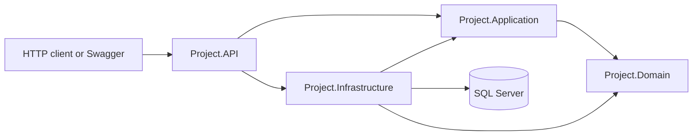
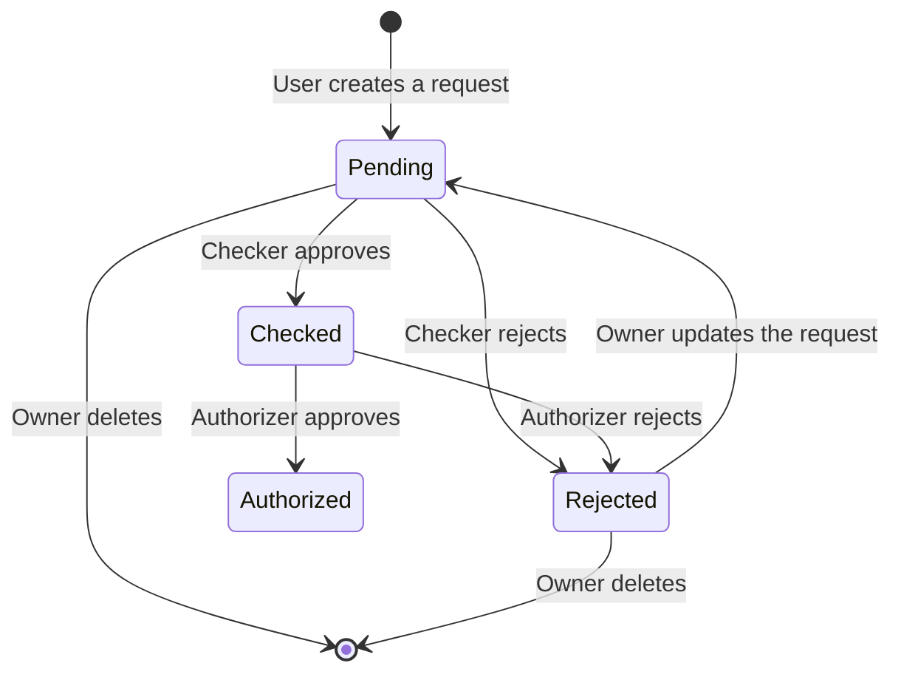
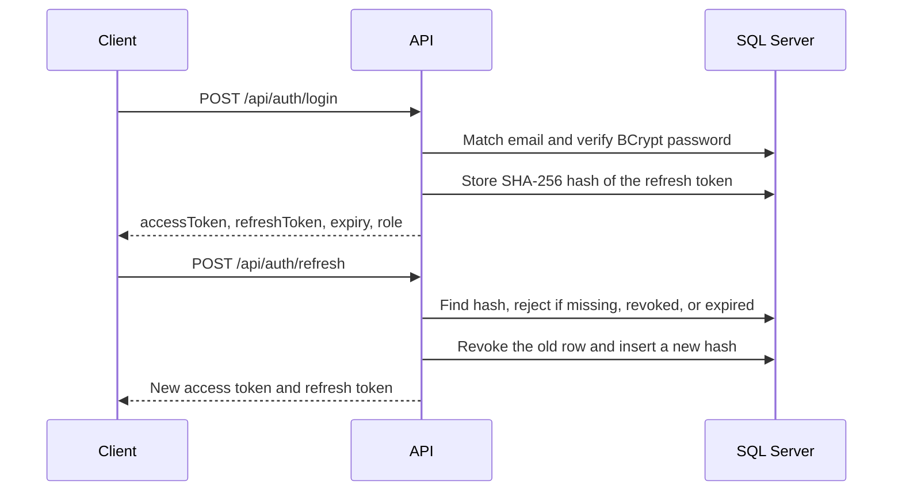
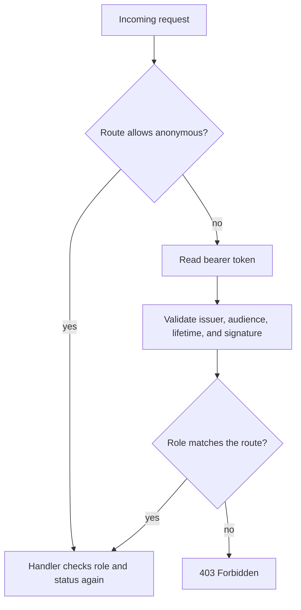
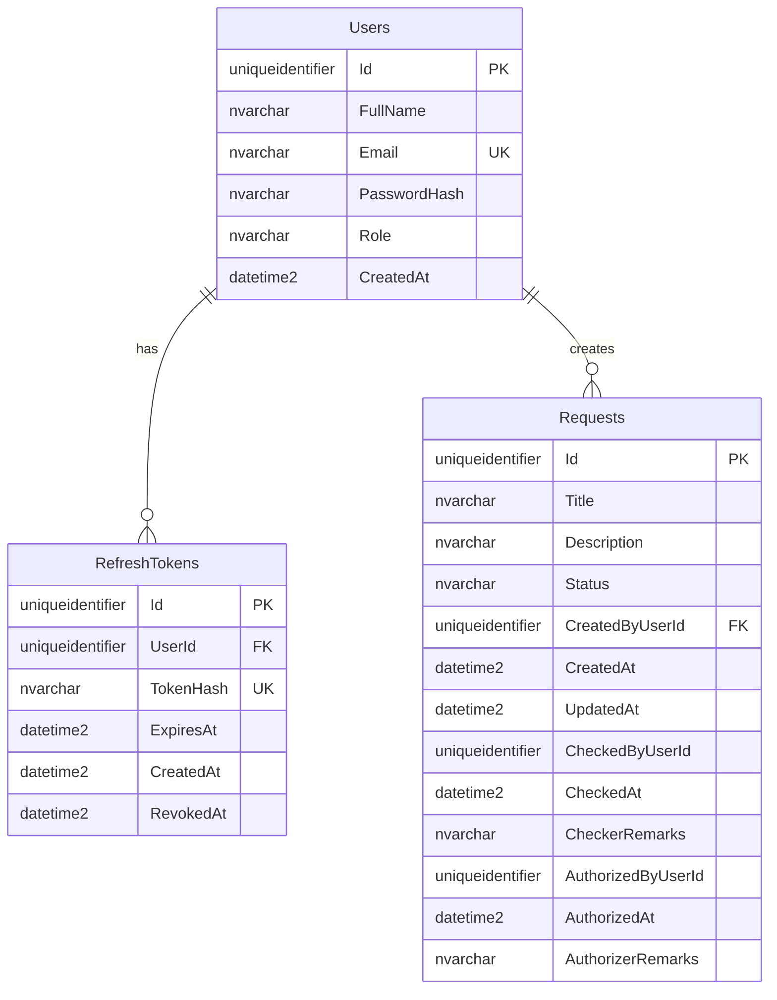

# ECB Work Request API

A role-based work-request API for ECB Technologies. Users submit requests, checkers review them, and authorizers give the final decision. The service is an ASP.NET Core Web API built with clean architecture, CQRS-style handlers, JWT authentication, and SQL Server.

[](https://github.com/rabbi1123/CRUD-application-developed-for-ECB-Technologies/actions/workflows/ci.yml)


Approval work often splits across people who create a request, people who review it, and people who authorize it. This API models that handoff. Each role sees only the queue it is allowed to act on, and a request can move forward only from a valid status.

Repository: [rabbi1123/CRUD-application-developed-for-ECB-Technologies](https://github.com/rabbi1123/CRUD-application-developed-for-ECB-Technologies)

## Contents

- [Overview](#overview)
- [Key features](#key-features)
- [Technology stack](#technology-stack)
- [Architecture and design](#architecture-and-design)
- [Project structure](#project-structure)
- [Getting started](#getting-started)
- [Configuration](#configuration)
- [API documentation](#api-documentation)
- [Authentication and authorization](#authentication-and-authorization)
- [Database design](#database-design)
- [Testing and code quality](#testing-and-code-quality)
- [CI/CD and deployment](#cicd-and-deployment)
- [Screenshots and demonstrations](#screenshots-and-demonstrations)
- [Roadmap](#roadmap)
- [Contributing](#contributing)
- [License](#license)
- [Contact](#contact)

## Overview

The API is a backend for a three-step work-request process.

| Role | Responsibility |
| --- | --- |
| **User** | Creates, updates, and deletes their own requests. |
| **Checker** | Reviews requests that are still pending. |
| **Authorizer** | Approves or rejects requests that a checker has already accepted. |

Public registration always creates a **User**. Checker and Authorizer accounts are created by the development seed so the full workflow can be exercised immediately.

### Objectives

- Keep request ownership and status transitions in one place.
- Enforce role rules in both the HTTP layer and the application handlers.
- Keep domain rules independent of ASP.NET Core and Entity Framework.
- Start the API, apply migrations, and seed demo users with one command.

### Who it is for

Software engineers reviewing the design, recruiters evaluating backend work, and contributors who want a small, tested .NET API to extend.

## Key features

### Implemented

- **Request workflow.** Pending → Checked → Authorized, with rejection from either review stage. An owner who edits a rejected request sends it back to Pending, and the previous review fields are cleared.
- **Ownership rules.** Users list and open only their own requests. Checkers see pending requests. Authorizers see checked requests.
- **Edit and delete limits.** Owners can update or delete a request only while it is Pending or Rejected.
- **JWT access tokens** signed with HMAC-SHA256. Issuer, audience, and lifetime are validated. Clock skew is one minute.
- **Refresh tokens** stored as SHA-256 hashes. Refresh rotates the token and revokes the previous one.
- **Password hashing** with BCrypt. Login uses a single error message for an unknown email and a wrong password.
- **Validation** with FluentValidation inside a MediatR pipeline. Invalid input returns HTTP 400 with field errors.
- **Consistent errors** as `application/problem+json`. Unexpected errors return a generic message outside Development.
- **Pagination** on list endpoints. Default page size is 10. The allowed range is 1–100.
- **Swagger UI** with a Bearer scheme. The site root redirects to `/swagger`.
- **Automatic database setup.** Startup applies EF Core migrations and seeds demo users when the user table is empty.
- **Docker Compose** for SQL Server 2022 and the API. The API container starts after SQL Server is healthy.
- **Automated tests** for handlers, infrastructure, and controller contracts, run in GitHub Actions.

### Planned

Planned work is listed in [Roadmap](#roadmap). It is not part of the current API.

## Technology stack

| Area | Choice | Why it is here |
| --- | --- | --- |
| Backend | .NET 8, C#, ASP.NET Core Web API | Hosts the HTTP API, JWT bearer authentication, and Swagger. |
| Application | MediatR 12, FluentValidation 11 | Each use case is a command or query with its own validator. |
| Database | SQL Server 2022, EF Core 8 | Relational storage, migrations, and unique indexes for email and refresh-token hashes. |
| Security | JWT Bearer, BCrypt.Net-Next | Short-lived access tokens and hashed passwords and refresh tokens. |
| API docs | Swashbuckle 6.4 | Interactive OpenAPI UI at `/swagger`. |
| Testing | xUnit, FluentAssertions, EF Core InMemory, Coverlet collector | Handler and infrastructure tests run without SQL Server. Coverlet is referenced; CI does not publish a coverage report. |
| DevOps | Docker, Docker Compose, GitHub Actions | Local stack and CI build, test, and image build. |

There is no frontend, message broker, or separate read store in this repository.

## Architecture and design

The solution follows clean architecture. Dependencies point inward: the API and infrastructure projects depend on the application layer, and the application layer depends only on the domain.



| Project | Responsibility |
| --- | --- |
| `Project.Domain` | `User`, `WorkRequest`, `RefreshToken`, and the role and status enums. No framework dependencies. |
| `Project.Application` | MediatR handlers, FluentValidation validators, DTOs, and ports such as `IApplicationDbContext`, `ICurrentUser`, `IJwtTokenService`, and `IPasswordHasher`. |
| `Project.Infrastructure` | SQL Server `AppDbContext`, EF configurations, migrations, seed data, BCrypt, and JWT creation. |
| `Project.API` | Controllers, current-user claims, bearer-token reading, exception middleware, and composition root. |

Controllers stay thin. They send a command or query through MediatR. `ValidationBehavior` runs registered validators before the handler. Handlers check the current role again, so authorization does not depend only on the controller attribute.

SQL Server access uses EF Core with transient-failure retries. List queries are read-only (`AsNoTracking`) and ordered by `CreatedAt` descending.

### Request lifecycle



Checked and Authorized requests stay as they are. The owner cannot edit or delete them.

### Login and refresh



Access tokens carry the user id, email, and role. The default lifetime is 30 minutes. Refresh tokens last 7 days. Both durations can be overridden with configuration.

## Project structure

```text
.
├── .github/workflows/ci.yml
├── Backend/
│   ├── Project.sln
│   ├── API/Project.API/
│   │   ├── Controllers/          Auth, user, checker, authorizer, dashboard
│   │   ├── Middleware/           Problem details for application exceptions
│   │   ├── Security/             Current user and bearer-token reader
│   │   ├── Program.cs
│   │   └── Dockerfile
│   ├── Core/
│   │   ├── Project.Domain/       Entities and enums
│   │   └── Project.Application/  Commands, queries, validation, abstractions
│   ├── Infrastructure/Project.Infrastructure/
│   │   ├── Persistence/          DbContext, configurations, migrations, seed
│   │   └── Security/             JWT and BCrypt
│   └── Tests/
│       ├── Project.API.Tests/
│       ├── Project.Application.Tests/
│       └── Project.Infrastructure.Tests/
├── docker-compose.yml
├── .env.example
└── README.md
```

`Backend/Project.sln` groups those projects into Core, Infrastructure, API, and Tests.

## Getting started

### Prerequisites

- [.NET 8 SDK](https://dotnet.microsoft.com/download/dotnet/8.0)
- [Docker Desktop](https://www.docker.com/products/docker-desktop/) with Docker Compose, for the container path
- SQL Server 2022 reachable from the machine, if you run the API with `dotnet run` outside Compose

### Run with Docker Compose

From the repository root:

```bash
cp .env.example .env
```

On Windows PowerShell:

```powershell
Copy-Item .env.example .env
```

Use these development values in `.env`. The SQL password in the connection string matches `MSSQL_SA_PASSWORD`.

```env
MSSQL_SA_PASSWORD=Ecb_Sql_Passw0rd!
ConnectionStrings__DefaultConnection=Server=sqlserver,1433;Database=EcbDb;User Id=sa;Password=Ecb_Sql_Passw0rd!;TrustServerCertificate=True
Jwt__Key=EcbDevSigningKey_MustBeAtLeast32Chars!
Jwt__Issuer=EcbApi
Jwt__Audience=EcbApi
```

```bash
docker compose up --build
```

- API: [http://localhost:8080](http://localhost:8080)
- Swagger: [http://localhost:8080/swagger](http://localhost:8080/swagger)
- SQL Server: `localhost,1433`

The API container waits until the SQL Server health check passes. On startup it applies migrations and, if `Users` is empty, inserts the demo accounts below.

Stop the stack with `docker compose down`. The database files stay in the `sqldata` volume. `docker compose down -v` removes that volume.

### Run the API on the host

Start only SQL Server if you want the API process on the host:

```bash
docker compose up sqlserver
```

`dotnet run` does not read `.env`. Set the variables in the shell. Use `localhost` here, because `sqlserver` is the hostname inside Compose.

PowerShell:

```powershell
$env:ConnectionStrings__DefaultConnection = "Server=localhost,1433;Database=EcbDb;User Id=sa;Password=Ecb_Sql_Passw0rd!;TrustServerCertificate=True"
$env:Jwt__Key = "EcbDevSigningKey_MustBeAtLeast32Chars!"
$env:Jwt__Issuer = "EcbApi"
$env:Jwt__Audience = "EcbApi"
dotnet run --project Backend/API/Project.API/Project.API.csproj --launch-profile http
```

bash:

```bash
export ConnectionStrings__DefaultConnection="Server=localhost,1433;Database=EcbDb;User Id=sa;Password=Ecb_Sql_Passw0rd!;TrustServerCertificate=True"
export Jwt__Key="EcbDevSigningKey_MustBeAtLeast32Chars!"
export Jwt__Issuer="EcbApi"
export Jwt__Audience="EcbApi"
dotnet run --project Backend/API/Project.API/Project.API.csproj --launch-profile http
```

The `http` launch profile listens on [http://localhost:5240](http://localhost:5240) and opens Swagger.

### Migrations

You do not need a separate migrate step to run the app. `DatabaseInitializer` calls `MigrateAsync` and then seeds users when the application starts.

To add a migration during development:

```bash
dotnet tool install --global dotnet-ef
dotnet ef migrations add <Name> \
  --project Backend/Infrastructure/Project.Infrastructure \
  --startup-project Backend/API/Project.API \
  --output-dir Persistence/Migrations
```

The design-time factory in `AppDbContextFactory` uses this connection string:

```text
Server=sqlserver,1433;Database=EcbDb;User Id=sa;Password=Ecb_Sql_Passw0rd!;TrustServerCertificate=True
```

Generate migrations from an environment where the host name `sqlserver` resolves, or change that factory connection string locally before running `dotnet ef`.

### Demo accounts

These accounts are inserted only when the database has no users. Every seed account uses the password `Password123!` from `SeedData`.

| Role | Email | Password |
| --- | --- | --- |
| User | `user@ecb.test` | `Password123!` |
| Checker | `checker@ecb.test` | `Password123!` |
| Authorizer | `authorizer@ecb.test` | `Password123!` |

Registration of a new account always creates the User role. New accounts choose their own password. The minimum length is 8 characters.

## Configuration

Copy [`.env.example`](.env.example) to `.env` for Compose. `.env` is gitignored.

| Variable | Development value | Purpose |
| --- | --- | --- |
| `MSSQL_SA_PASSWORD` | `Ecb_Sql_Passw0rd!` | SA password for the SQL Server container. |
| `ConnectionStrings__DefaultConnection` | `Server=sqlserver,1433;Database=EcbDb;User Id=sa;Password=Ecb_Sql_Passw0rd!;TrustServerCertificate=True` | EF Core connection string inside Compose. The server host is `sqlserver`. |
| Host connection string | `Server=localhost,1433;Database=EcbDb;User Id=sa;Password=Ecb_Sql_Passw0rd!;TrustServerCertificate=True` | Same database and password for `dotnet run` on the host. |
| Design-time connection string | `Server=sqlserver,1433;Database=EcbDb;User Id=sa;Password=Ecb_Sql_Passw0rd!;TrustServerCertificate=True` | Hard-coded in `AppDbContextFactory` for `dotnet ef`. |
| `Jwt__Key` | `EcbDevSigningKey_MustBeAtLeast32Chars!` | HMAC signing key. Startup fails if it is missing or shorter than 32 characters. |
| `Jwt__Issuer` | `EcbApi` | Expected JWT issuer. |
| `Jwt__Audience` | `EcbApi` | Expected JWT audience. |
| Seed password | `Password123!` | Password for `user@ecb.test`, `checker@ecb.test`, and `authorizer@ecb.test`. |
| `Jwt__AccessTokenMinutes` | `30` when omitted | Access-token lifetime. |
| `Jwt__RefreshTokenDays` | `7` when omitted | Refresh-token lifetime. |
| `ASPNETCORE_ENVIRONMENT` | `Development` in Compose | Development includes exception messages on HTTP 500 responses. |

`appsettings.json` contains logging and `AllowedHosts` only. The API reads the connection string and JWT settings from environment variables.

Development `.env`:

```env
MSSQL_SA_PASSWORD=Ecb_Sql_Passw0rd!
ConnectionStrings__DefaultConnection=Server=sqlserver,1433;Database=EcbDb;User Id=sa;Password=Ecb_Sql_Passw0rd!;TrustServerCertificate=True
Jwt__Key=EcbDevSigningKey_MustBeAtLeast32Chars!
Jwt__Issuer=EcbApi
Jwt__Audience=EcbApi
```

## API documentation

Swagger UI is available at `/swagger` whenever the API is running. For Bearer auth, paste the `accessToken` value from login. The UI adds the `Bearer` prefix. A raw token in the `Authorization` header is also accepted.

Base URL with Compose: `http://localhost:8080`  
Base URL with `dotnet run`: `http://localhost:5240`

### Endpoints

| Method | Route | Auth | Description |
| --- | --- | --- | --- |
| `POST` | `/api/auth/register` | Anonymous | Create a User account. Returns `201`. |
| `POST` | `/api/auth/login` | Anonymous | Issue an access token and a refresh token. |
| `POST` | `/api/auth/refresh` | Anonymous | Rotate a valid refresh token. |
| `GET` | `/api/dashboard` | Any authenticated role | Role-specific dashboard message. |
| `GET` | `/api/user/requests` | User | Page through the caller's requests. |
| `GET` | `/api/user/requests/{id}` | User | Get one request owned by the caller. |
| `POST` | `/api/user/requests` | User | Create a Pending request. Returns `201`. |
| `PUT` | `/api/user/requests/{id}` | User | Update a Pending or Rejected request owned by the caller. |
| `DELETE` | `/api/user/requests/{id}` | User | Delete a Pending or Rejected request owned by the caller. Returns `204`. |
| `GET` | `/api/checker/requests` | Checker | Page through Pending requests. |
| `GET` | `/api/checker/requests/{id}` | Checker | Get one Pending request. |
| `POST` | `/api/checker/requests/{id}/approve` | Checker | Move Pending → Checked. |
| `POST` | `/api/checker/requests/{id}/reject` | Checker | Move Pending → Rejected. |
| `GET` | `/api/authorizer/requests` | Authorizer | Page through Checked requests. |
| `GET` | `/api/authorizer/requests/{id}` | Authorizer | Get one Checked request. |
| `POST` | `/api/authorizer/requests/{id}/approve` | Authorizer | Move Checked → Authorized. |
| `POST` | `/api/authorizer/requests/{id}/reject` | Authorizer | Move Checked → Rejected. |

List routes accept `page` (default `1`) and `pageSize` (default `10`, maximum `100`).

### Register

`POST /api/auth/register`

```json
{
  "fullName": "Ada Lovelace",
  "email": "ada@ecb.test",
  "password": "Password123!"
}
```

`201 Created`

```json
{
  "id": "7c9e6679-7425-40de-944b-e07fc1f90ae7",
  "fullName": "Ada Lovelace",
  "email": "ada@ecb.test",
  "role": "User"
}
```

`fullName` max 200, `email` max 256, `password` 8–100 characters. Duplicate emails return `409`.

### Login

`POST /api/auth/login`

```json
{
  "email": "user@ecb.test",
  "password": "Password123!"
}
```

`200 OK`

```json
{
  "accessToken": "<jwt>",
  "refreshToken": "<token>",
  "accessTokenExpiresAt": "2026-10-18T12:30:00Z",
  "role": "User"
}
```

Call protected routes with:

```http
Authorization: Bearer <accessToken>
```

### Refresh

`POST /api/auth/refresh`

```json
{
  "refreshToken": "<token>"
}
```

The response shape matches login. The previous refresh token cannot be used again.

### Create a request

`POST /api/user/requests`

```json
{
  "title": "Replace the office printer",
  "description": "The third-floor printer no longer feeds paper."
}
```

`201 Created`

```json
{
  "id": "3fa85f64-5717-4562-b3fc-2c963f66afa6",
  "title": "Replace the office printer",
  "description": "The third-floor printer no longer feeds paper.",
  "status": "Pending",
  "createdByUserId": "7c9e6679-7425-40de-944b-e07fc1f90ae7",
  "createdAt": "2026-10-18T12:00:00Z",
  "updatedAt": "2026-10-18T12:00:00Z",
  "checkedAt": null,
  "checkerRemarks": null,
  "authorizedAt": null,
  "authorizerRemarks": null
}
```

`title` max 200 characters. `description` max 2000 characters.

### List

`GET /api/user/requests?page=1&pageSize=10`

```json
{
  "items": [],
  "page": 1,
  "pageSize": 10,
  "totalCount": 0
}
```

Checker and authorizer lists use the same page shape. Their queues are filtered by status.

### Review

Approve has an empty body.

`POST /api/checker/requests/{id}/approve`  
`POST /api/authorizer/requests/{id}/approve`

Reject accepts an optional remark of up to 1000 characters.

`POST /api/checker/requests/{id}/reject`  
`POST /api/authorizer/requests/{id}/reject`

```json
{
  "remarks": "Need a cost estimate before this can proceed."
}
```

### Dashboard

`GET /api/dashboard` returns a short message for the caller's role, for example `"This is User Page"`.

### Error shape

Failures use `application/problem+json`.

| Status | When |
| --- | --- |
| `400` | Validation failed. The body includes an `errors` map. |
| `401` | Missing or invalid credentials, or an unusable refresh token. |
| `403` | The role cannot perform the action. |
| `404` | The request does not exist, or a user asked for a request they do not own. |
| `409` | Duplicate email, or a status transition that the current role cannot make. |
| `500` | Unexpected error. The detailed message is included in Development only. |

## Authentication and authorization



| Rule | Behavior |
| --- | --- |
| Registration | Open. The new account is always `User`. |
| Login | Email is trimmed and compared case-insensitively. |
| Access token | Claims: name identifier, email, role. |
| Refresh token | Random 64-byte value. Only the SHA-256 hash is stored. Reuse after rotation fails. |
| User routes | The caller must own the request. Another user's id returns `404`. |
| Checker routes | Pending requests only. |
| Authorizer routes | Checked requests only. |
| Dashboard | Any of the three roles. |

There is no logout endpoint. A refresh token remains usable until it expires or is rotated. There is no admin API for assigning Checker or Authorizer.

## Database design

Database name in the sample connection string: `EcbDb`.



| Table | Notes |
| --- | --- |
| `Users` | Unique email. `Role` is stored as a string: `User`, `Checker`, or `Authorizer`. |
| `RefreshTokens` | Cascade-deleted with the user. `TokenHash` is unique. |
| `Requests` | Status is stored as a string: `Pending`, `Checked`, `Authorized`, or `Rejected`. Indexed on status and `CreatedByUserId`. Deleting the creator is restricted. |

`CheckedByUserId` and `AuthorizedByUserId` are stored on the request. They are not foreign keys, and the API response does not return those user ids. It returns the timestamps and remarks.

The initial migration is `20261018084113_InitialCreate`.

## Testing and code quality

Tests are unit tests. They do not start SQL Server or the HTTP pipeline end to end.

| Project | What it covers |
| --- | --- |
| `Project.Application.Tests` | Auth, request workflow, dashboard, and validation. Handlers use the EF Core in-memory provider. |
| `Project.Infrastructure.Tests` | BCrypt, JWT issuing, seed data, entity configuration, and dependency injection. |
| `Project.API.Tests` | Controller status codes, route and role attributes, the bearer-token reader, current-user claims, and the exception middleware. |

From the repository root:

```bash
dotnet test Backend/Project.sln --configuration Release
```

Coverlet is included as a test collector. The CI workflow does not pass `--collect`, and there is no coverage gate. There is no `.editorconfig`, analyzer ruleset, or formatter configuration in the repository. Nullable reference types and implicit usings are enabled on the projects.

## CI/CD and deployment

Workflow: [`.github/workflows/ci.yml`](.github/workflows/ci.yml).

| Trigger | Jobs |
| --- | --- |
| Push to any branch | Restore, Release build, and `dotnet test` on `ubuntu-latest`. |
| Pull request into `master` | Build the API image as `ecb-api:<commit-sha>`, and run the unit tests in a separate job. |

In-progress runs for the same branch or pull request are cancelled. The workflow has `contents: read` only. It does not push the image to a registry and does not deploy.

Build the image locally:

```bash
docker build --file Backend/API/Project.API/Dockerfile --tag ecb-api:local .
```

The image listens on port `8080`. Running it still requires the connection string and JWT settings, which Compose supplies from `.env`.

### Not automated yet

- Publishing an image to a container registry
- Deploying to a host
- Coverage upload
- Integration tests against SQL Server

## Screenshots and demonstrations

No screenshots, GIFs, or hosted demo are checked in.

| Placeholder | Intended content |
| --- | --- |
| `docs/screenshots/swagger.png` | Swagger UI after login |
| `docs/screenshots/workflow.gif` | Create, check, and authorize a request |

Until those assets exist, run the API and open `/swagger`.

## Roadmap

- A small UI for the User, Checker, and Authorizer queues
- Logout and explicit refresh-token revocation
- An admin path for assigning Checker and Authorizer roles
- HTTPS termination and a non-development configuration profile
- Integration tests against SQL Server
- Coverage collection in CI
- A health endpoint for the API
- A history of status changes, beyond the latest checker and authorizer fields
- Publishing the Docker image from GitHub Actions

## Contributing

1. Fork the repository and clone your fork.
2. Create a branch from the current default branch.
3. Keep changes focused. Domain rules belong in `Project.Application` handlers, persistence in `Project.Infrastructure`, and HTTP details in `Project.API`.
4. Add or update tests for behavior you change.
5. Run `dotnet test Backend/Project.sln --configuration Release`.
6. Open a pull request. Pull requests into `master` run the unit tests and a Docker image build.

The development connection string, SQL password, JWT key, issuer, audience, and seed password are listed in [Configuration](#configuration). `.env` stays gitignored.

## License

A license has not been added to this repository. All rights belong to the copyright holder until a `LICENSE` file is published.

## Contact

Questions and issues go through the [GitHub repository](https://github.com/rabbi1123/CRUD-application-developed-for-ECB-Technologies).
